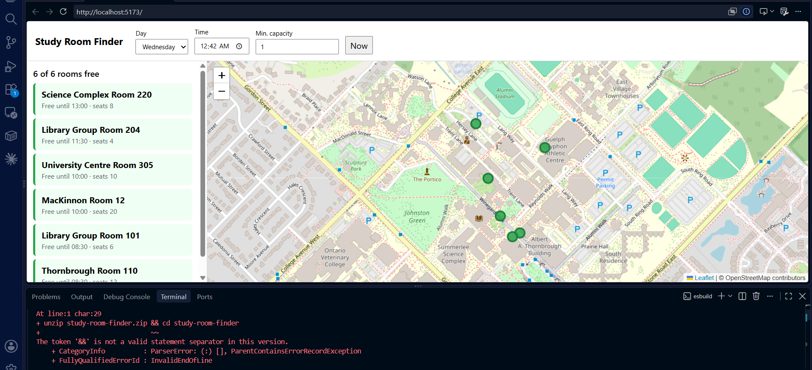

# Study Room Finder

Find a free study room on campus right now. Pick a day and time, and the app shows
which rooms are open, how long they stay free, and where they are on a map.


<!-- Add a screenshot or GIF, plus a live demo link: https://<you>.github.io/study-room-finder -->

**Live demo:** _add link after deploying_

## Features
- Free/busy status for every room at any day and time, with "free until HH:MM"
- Interactive map (Leaflet + OpenStreetMap), click a room to fly to it
- Filter by minimum capacity
- Fully client-side: static JSON in, no backend to run

## Getting started
```bash
npm install
npm run dev     # local dev server
npm test        # unit tests
npm run build   # type-check + production build
```

## How it works
Core logic lives in `src/rooms.ts` and has no DOM or map dependencies, so it is
easy to test (`src/rooms.test.ts`). Bookings use half-open intervals
(`start` inclusive, `end` exclusive), and back-to-back bookings are chained so a
room that is booked 10:00-11:00 and 11:00-12:00 reports as busy until 12:00.

Data format (`public/data/schedule.json`):
```json
{
  "rooms":    [{ "id": "lib-101", "building": "Library", "name": "Group Room 101", "capacity": 6, "lat": 43.53, "lng": -80.22 }],
  "bookings": [{ "roomId": "lib-101", "day": 1, "start": "09:00", "end": "10:30" }]
}
```
`day` is 0 (Sunday) to 6 (Saturday).

> The included dataset is generated sample data, not real timetables.

## Decisions and tradeoffs
- **Client-side only:** keeps hosting free and the demo instant; the tradeoff is that
  data is static, not live.
- **Vanilla TypeScript, no framework:** the UI is small, so I kept the bundle tiny and
  put effort into a tested core instead.
- **Circle markers instead of default pins:** avoids Leaflet's icon-path issues with bundlers.

## Roadmap
- [ ] Import real timetable data (CSV/iCal) with a conversion script
- [ ] "Free for the next N minutes" filter
- [ ] Shareable URL state (day, time, capacity)
- [ ] Accessibility pass (keyboard nav for the room list)
- [ ] Deploy with GitHub Pages workflow
